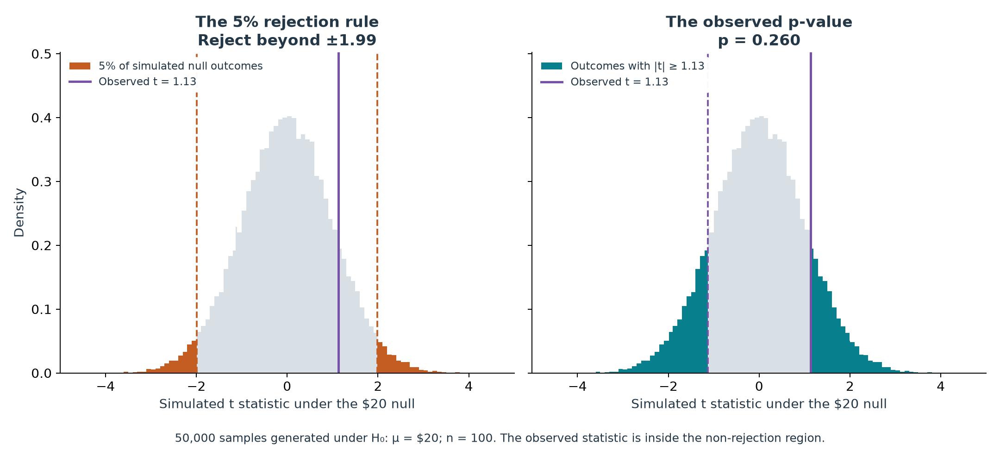

```{r}
#| include: false
if (Sys.getenv("RETICULATE_PYTHON") == "") {
  Sys.setenv(
    RETICULATE_PYTHON = path.expand("~/aeds6400-python/bin/python")
  )
}

Sys.setenv(
  MPLCONFIGDIR = file.path(tempdir(), "blog8-matplotlib")
)

library(reticulate)

knitr::opts_knit$set(
  root.dir = normalizePath(
    dirname(knitr::current_input(dir = TRUE))
  )
)
```

```{python}
#| label: reproduce-results
#| include: false

from pathlib import Path
import json
import os
import tempfile

import numpy as np
import pandas as pd

os.environ.setdefault(
    "MPLCONFIGDIR",
    str(Path(tempfile.gettempdir()) / "blog8-matplotlib")
)

import matplotlib
matplotlib.use("Agg")

import matplotlib.pyplot as plt
from matplotlib.lines import Line2D
from matplotlib.patches import Patch
import plotly.graph_objects as go


# ------------------------------------------------------------
# Simulation settings
# ------------------------------------------------------------

ROOT = Path.cwd()

SEED = 20261101
TRUE_MEAN, SD, N = 21.0, 4.0, 100

B = 5000
R = 5000
B_COVERAGE = 2000
M = 50000

NAVY = "#243746"
BLUE = "#087F8C"
ORANGE = "#C45D21"
GREEN = "#328256"
PURPLE = "#7851A9"
GRAY = "#D8DFE5"


def bootstrap_means(sample, repetitions, rng):
    """Resample the observed workers with replacement."""
    resamples = rng.choice(
        sample,
        size=(repetitions, len(sample)),
        replace=True
    )
    return resamples.mean(axis=1)


def run_analysis():
    data = ROOT / "data"
    tables = ROOT / "results/tables"

    data.mkdir(parents=True, exist_ok=True)
    tables.mkdir(parents=True, exist_ok=True)

    # Separate random streams for the different experiments.
    streams = np.random.SeedSequence(SEED).spawn(5)

    rng_data, rng_boot, rng_samples, rng_resamples, rng_null = [
        np.random.default_rng(s) for s in streams
    ]

    # 1. One original sample and its bootstrap distribution.
    wages = rng_data.normal(TRUE_MEAN, SD, N)

    boot = bootstrap_means(wages, B, rng_boot)
    lower, upper = np.quantile(boot, [0.025, 0.975])

    pd.DataFrame({"wage": wages}).to_csv(
        data / "observed_wages.csv",
        index=False
    )

    pd.DataFrame({"mean": boot}).to_csv(
        tables / "bootstrap_means.csv",
        index=False
    )

    # 2. Repeated population sampling to measure CI coverage.
    records = []
    coverage_rows = []

    for n in [25, 100, 400]:
        for replication in range(1, R + 1):
            sample = rng_samples.normal(TRUE_MEAN, SD, n)

            means = bootstrap_means(
                sample,
                B_COVERAGE,
                rng_resamples
            )

            lo, hi = np.quantile(means, [0.025, 0.975])

            records.append({
                "n": n,
                "replicate": replication,
                "mean": sample.mean(),
                "lower": lo,
                "upper": hi,
                "covers": lo <= TRUE_MEAN <= hi,
                "width": hi - lo
            })

        group = pd.DataFrame(records).query("n == @n")
        coverage = group["covers"].mean()

        coverage_rows.append({
            "n": n,
            "replications": R,
            "covered": int(group["covers"].sum()),
            "coverage": coverage,
            "mc_se": np.sqrt(coverage * (1 - coverage) / R),
            "mean_width": group["width"].mean()
        })

    pd.DataFrame(records).to_csv(
        tables / "coverage_intervals.csv",
        index=False
    )

    pd.DataFrame(coverage_rows).to_csv(
        tables / "coverage_summary.csv",
        index=False
    )

    # 3. Simulate t statistics under H0: mean wage is $20.
    null_mean = 20.0

    observed_t = (
        (wages.mean() - null_mean)
        / (wages.std(ddof=1) / np.sqrt(N))
    )

    null_samples = rng_null.normal(
        null_mean,
        SD,
        size=(M, N)
    )

    null_t = (
        (null_samples.mean(axis=1) - null_mean)
        / (null_samples.std(axis=1, ddof=1) / np.sqrt(N))
    )

    critical_abs = np.quantile(np.abs(null_t), 0.95)

    extreme = int(
        np.sum(np.abs(null_t) >= abs(observed_t))
    )

    p_value = (extreme + 1) / (M + 1)

    pd.DataFrame({"t": null_t}).to_csv(
        tables / "null_statistics.csv",
        index=False
    )

    summary = {
        "seed": SEED,
        "true_mean": TRUE_MEAN,
        "sd": SD,
        "n": N,
        "bootstrap_resamples": B,
        "coverage_replications": R,
        "coverage_resamples": B_COVERAGE,
        "null_simulations": M,
        "null_mean": null_mean,
        "sample_mean": float(wages.mean()),
        "sample_sd": float(wages.std(ddof=1)),
        "ci_lower": float(lower),
        "ci_upper": float(upper),
        "observed_t": float(observed_t),
        "critical_abs": float(critical_abs),
        "extreme_count": extreme,
        "p_value": float(p_value),
        "p_mc_se": float(
            np.sqrt(p_value * (1 - p_value) / M)
        ),
        "reject_5_percent": bool(
            abs(observed_t) > critical_abs
        ),
        "coverage": coverage_rows
    }

    (ROOT / "results/summary.json").write_text(
        json.dumps(summary, indent=2)
    )

    return summary


def make_figures(root):
    root = Path(root)
    figures = root / "results/figures"
    tables = root / "results/tables"

    figures.mkdir(parents=True, exist_ok=True)

    info = json.loads(
        (root / "results/summary.json").read_text()
    )

    boot = pd.read_csv(
        tables / "bootstrap_means.csv"
    )["mean"].to_numpy()

    intervals = pd.read_csv(
        tables / "coverage_intervals.csv"
    )

    coverage = pd.read_csv(
        tables / "coverage_summary.csv"
    ).set_index("n")

    null_t = pd.read_csv(
        tables / "null_statistics.csv"
    )["t"].to_numpy()

    plt.rcParams.update({
        "font.family": "DejaVu Sans",
        "font.size": 11,
        "axes.spines.top": False,
        "axes.spines.right": False,
        "axes.labelcolor": NAVY,
        "text.color": NAVY,
        "axes.titleweight": "bold",
        "savefig.facecolor": "white"
    })

    config = {
        "responsive": True,
        "displayModeBar": False
    }

    # --------------------------------------------------------
    # Figure 1: animated bootstrap distribution
    # --------------------------------------------------------

    counts = [100, 500, 1000, 5000]
    edges = np.linspace(
        boot.min() - 0.05,
        boot.max() + 0.05,
        36
    )

    centers = (edges[:-1] + edges[1:]) / 2

    densities = [
        np.histogram(
            boot[:b], bins=edges, density=True
        )[0]
        for b in counts
    ]

    ymax = max(a.max() for a in densities) * 1.2

    def boot_shapes(b):
        lower, upper = np.quantile(
            boot[:b], [0.025, 0.975]
        )

        lines = [
            (info["sample_mean"], NAVY, "dash"),
            (info["true_mean"], GREEN, "solid"),
            (lower, ORANGE, "dot"),
            (upper, ORANGE, "dot")
        ]

        return [
            dict(
                type="line",
                x0=x, x1=x,
                y0=0, y1=1,
                yref="paper",
                line=dict(
                    color=color,
                    dash=dash,
                    width=2
                )
            )
            for x, color, dash in lines
        ]

    def boot_title(b):
        lower, upper = np.quantile(
            boot[:b], [0.025, 0.975]
        )

        return (
            "More resamples, the same 100 workers"
            f"<br><sup>B = {b:,} | 95% percentile interval: "
            f"${lower:.2f}–${upper:.2f}"
            f" | width ${upper - lower:.2f}</sup>"
        )

    def bar(a):
        return go.Bar(
            x=centers,
            y=a,
            width=np.diff(edges) * 0.96,
            marker_color=BLUE,
            showlegend=False,
            hovertemplate=(
                "Bootstrap mean: $%{x:.2f}"
                "<br>Density: %{y:.3f}<extra></extra>"
            )
        )

    fig = go.Figure(data=[bar(densities[-1])])

    for name, color, dash in [
        ("Sample mean", NAVY, "dash"),
        ("True mean = $21", GREEN, "solid"),
        ("95% interval endpoints", ORANGE, "dot")
    ]:
        fig.add_trace(
            go.Scatter(
                x=[None],
                y=[None],
                mode="lines",
                name=name,
                line=dict(
                    color=color,
                    dash=dash,
                    width=2
                )
            )
        )

    fig.frames = [
        go.Frame(
            name=str(b),
            data=[bar(a)],
            traces=[0],
            layout=go.Layout(
                shapes=boot_shapes(b),
                title=dict(text=boot_title(b))
            )
        )
        for b, a in zip(counts, densities)
    ]

    steps = [
        dict(
            label=f"{b:,}",
            method="animate",
            args=[
                [str(b)],
                {
                    "mode": "immediate",
                    "frame": {
                        "duration": 0,
                        "redraw": True
                    },
                    "transition": {"duration": 0}
                }
            ]
        )
        for b in counts
    ]

    fig.update_layout(
        template="plotly_white",
        height=570,
        title=dict(
            text=boot_title(5000),
            x=0.02,
            y=0.98,
            yanchor="top"
        ),
        font=dict(
            family="Arial, sans-serif",
            size=13,
            color=NAVY
        ),
        margin=dict(l=65, r=25, t=125, b=140),
        shapes=boot_shapes(5000),
        xaxis=dict(
            title="Bootstrap mean hourly wage ($)",
            range=[edges[0], edges[-1]],
            fixedrange=True
        ),
        yaxis=dict(
            title="Density",
            range=[0, ymax],
            fixedrange=True
        ),
        legend=dict(
            orientation="h",
            x=0,
            y=1.15,
            font=dict(size=11)
        ),
        sliders=[
            dict(
                active=3,
                steps=steps,
                x=0.22,
                len=0.77,
                y=-0.23,
                currentvalue=dict(prefix="Resamples: "),
                pad=dict(t=0)
            )
        ],
        updatemenus=[
            dict(
                type="buttons",
                direction="left",
                x=0,
                y=-0.23,
                xanchor="left",
                yanchor="top",
                showactive=False,
                buttons=[
                    dict(
                        label="Play",
                        method="animate",
                        args=[
                            None,
                            {
                                "fromcurrent": False,
                                "mode": "immediate",
                                "frame": {
                                    "duration": 1200,
                                    "redraw": True
                                },
                                "transition": {"duration": 0}
                            }
                        ]
                    ),
                    dict(
                        label="Pause",
                        method="animate",
                        args=[
                            [None],
                            {
                                "mode": "immediate",
                                "frame": {"duration": 0},
                                "transition": {"duration": 0}
                            }
                        ]
                    )
                ]
            )
        ]
    )

    fig.write_html(
        figures / "bootstrap.html",
        include_plotlyjs=True,
        auto_play=False,
        config=config
    )

    # Static version of Figure 1.
    fig1, ax = plt.subplots(figsize=(10, 5.5))

    ax.bar(
        centers,
        densities[-1],
        width=np.diff(edges) * 0.96,
        color=BLUE,
        alpha=0.85
    )

    for x, color, style, label in [
        (info["sample_mean"], NAVY, "--", "Sample mean"),
        (info["true_mean"], GREEN, "-", "True mean = $21"),
        (
            info["ci_lower"], ORANGE, ":",
            "95% interval endpoints"
        ),
        (info["ci_upper"], ORANGE, ":", None)
    ]:
        ax.axvline(
            x,
            color=color,
            linestyle=style,
            lw=2,
            label=label
        )

    ax.set(
        xlabel="Bootstrap mean hourly wage ($)",
        ylabel="Density",
        ylim=(0, ymax),
        title=(
            "The bootstrap distribution from "
            "one sample of 100 workers"
        )
    )

    ax.legend(
        frameon=False,
        loc="upper left",
        fontsize=9
    )

    fig1.text(
        0.5, 0.01,
        f"5,000 resamples | Sample mean "
        f"${info['sample_mean']:.2f} | "
        f"95% percentile interval "
        f"[${info['ci_lower']:.2f}, ${info['ci_upper']:.2f}]",
        ha="center",
        fontsize=10
    )

    fig1.tight_layout(rect=[0, 0.035, 1, 1])
    fig1.savefig(figures / "bootstrap.png", dpi=180)
    plt.close(fig1)

    # --------------------------------------------------------
    # Figure 2: repeated-sample confidence intervals
    # --------------------------------------------------------

    sizes = sorted(coverage.index.astype(int))
    first = intervals.groupby("n", sort=False).head(100)

    x_range = [
        np.floor(first.lower.min() * 2) / 2,
        np.ceil(first.upper.max() * 2) / 2
    ]

    # Static comparison across all three sample sizes.
    fig2, axes = plt.subplots(
        1,
        len(sizes),
        figsize=(4.1 * len(sizes), 6.8),
        sharex=True,
        sharey=True
    )

    for ax, n in zip(np.atleast_1d(axes), sizes):
        part = first[first.n == n]
        row = coverage.loc[n]

        colors = np.where(part.covers, BLUE, ORANGE)

        ax.hlines(
            part.replicate,
            part.lower,
            part.upper,
            color=colors,
            lw=1.2
        )

        ax.scatter(
            part["mean"],
            part.replicate,
            color=colors,
            s=5
        )

        ax.axvline(
            info["true_mean"],
            color=GREEN,
            lw=1.6
        )

        ax.set(
            xlim=x_range,
            ylim=(101, 0),
            xlabel=(
                "Mean hourly wage ($)\n"
                f"First 100: {int(part.covers.sum())} cover, "
                f"{int((~part.covers).sum())} miss"
            )
        )

        ax.set_title(
            f"n = {n}\n"
            f"Coverage: {row.coverage:.2%} "
            f"(SE {row.mc_se * 100:.2f} pp)\n"
            f"Average width: ${row.mean_width:.2f}",
            fontsize=11
        )

        ax.grid(axis="x", alpha=0.15)

    axes[0].set_ylabel("Repeated sample (first 100)")

    fig2.suptitle(
        "Larger samples give narrower intervals",
        fontsize=17,
        weight="bold",
        y=0.99
    )

    fig2.text(
        0.5, 0.935,
        f"Rates use all {info['coverage_replications']:,} "
        "independent samples per size; "
        f"{info['coverage_resamples']:,} resamples per interval.",
        ha="center",
        fontsize=10
    )

    fig2.legend(
        handles=[
            Line2D(
                [0], [0],
                color=BLUE,
                label="Contains $21"
            ),
            Line2D(
                [0], [0],
                color=ORANGE,
                label="Misses $21"
            ),
            Line2D(
                [0], [0],
                color=GREEN,
                label="True mean = $21"
            )
        ],
        loc="lower center",
        ncol=3,
        frameon=False,
        bbox_to_anchor=(0.5, 0.005)
    )

    fig2.tight_layout(rect=[0, 0.08, 1, 0.91])
    fig2.savefig(figures / "coverage.png", dpi=180)
    plt.close(fig2)

    # Interactive version with a sample-size dropdown.
    covfig = go.Figure()

    for n in sizes:
        part = first[first.n == n]

        for hit, label, color in [
            (True, "Contains $21", BLUE),
            (False, "Misses $21", ORANGE)
        ]:
            x, y, text = [], [], []

            for r in part[part.covers == hit].itertuples():
                x.extend([r.lower, r.upper, None])
                y.extend([r.replicate, r.replicate, None])

                tip = (
                    f"Sample {r.replicate}"
                    f"<br>95% CI: "
                    f"[${r.lower:.2f}, ${r.upper:.2f}]"
                )

                text.extend([tip, tip, None])

            covfig.add_trace(
                go.Scatter(
                    x=x,
                    y=y,
                    mode="lines+markers",
                    name=label,
                    line=dict(color=color, width=2),
                    marker=dict(size=3),
                    text=text,
                    hovertemplate="%{text}<extra></extra>",
                    visible=(n == 100)
                )
            )

    def coverage_title(n):
        row = coverage.loc[n]
        part = first[first.n == n]

        return (
            f"Coverage across repeated samples: n = {n}"
            f"<br><sup>All {int(row.replications):,} samples: "
            f"{row.coverage:.2%} cover $21"
            f" | Monte Carlo SE: {row.mc_se * 100:.2f} "
            "percentage points"
            f"<br>Average width: ${row.mean_width:.2f}"
            f" | First 100 shown: "
            f"{int(part.covers.sum())} cover</sup>"
        )

    buttons = [
        dict(
            label=f"n = {n}",
            method="update",
            args=[
                {
                    "visible": [
                        k == n
                        for k in sizes
                        for _ in range(2)
                    ]
                },
                {"title.text": coverage_title(n)}
            ]
        )
        for n in sizes
    ]

    covfig.update_layout(
        template="plotly_white",
        height=700,
        font=dict(
            family="Arial, sans-serif",
            size=13,
            color=NAVY
        ),
        title=dict(
            text=coverage_title(100),
            x=0.02,
            y=0.98,
            yanchor="top",
            font=dict(size=17)
        ),
        margin=dict(l=65, r=30, t=145, b=65),
        xaxis=dict(
            title="Mean hourly wage ($)",
            range=x_range,
            fixedrange=True
        ),
        yaxis=dict(
            title="Repeated sample (first 100)",
            range=[101, 0],
            fixedrange=True,
            dtick=20
        ),
        shapes=[
            dict(
                type="line",
                x0=21,
                x1=21,
                y0=0,
                y1=1,
                yref="paper",
                line=dict(color=GREEN, width=2)
            )
        ],
        legend=dict(
            orientation="h",
            x=0.32,
            y=1.07
        ),
        updatemenus=[
            dict(
                buttons=buttons,
                active=sizes.index(100),
                x=0,
                y=1.09,
                xanchor="left",
                yanchor="top"
            )
        ]
    )

    covfig.write_html(
        figures / "coverage.html",
        include_plotlyjs=True,
        config=config
    )

    # --------------------------------------------------------
    # Figure 3: rejection regions and p-value tails
    # --------------------------------------------------------

    critical = info["critical_abs"]
    observed = info["observed_t"]
    extreme = abs(observed)

    extent = max(
        4.5,
        np.ceil(
            max(np.abs(null_t).max(), extreme) * 2
        ) / 2
    )

    edges = np.unique(
        np.r_[
            np.linspace(-extent, extent, 101),
            -critical,
            critical,
            -extreme,
            extreme
        ]
    )

    density = (
        np.histogram(null_t, bins=edges)[0]
        / len(null_t)
        / np.diff(edges)
    )

    centers = (edges[:-1] + edges[1:]) / 2
    widths = np.diff(edges)

    fig3, axes = plt.subplots(
        1,
        2,
        figsize=(12, 5.4),
        sharex=True,
        sharey=True
    )

    for ax in axes:
        ax.bar(
            centers,
            density,
            width=widths,
            color=GRAY,
            align="center"
        )

        ax.set(
            xlabel="Simulated t statistic under the $20 null",
            xlim=(-extent, extent),
            ylim=(0, density.max() * 1.25)
        )

        ax.axvline(
            observed,
            color=PURPLE,
            lw=2,
            label=f"Observed t = {observed:.2f}"
        )

    axes[0].set_ylabel("Density")

    # Left panel: the fixed rejection rule.
    mask = np.abs(centers) > critical

    axes[0].bar(
        centers[mask],
        density[mask],
        width=widths[mask],
        color=ORANGE
    )

    for c in [-critical, critical]:
        axes[0].axvline(
            c,
            color=ORANGE,
            ls="--",
            lw=1.5
        )

    axes[0].set_title(
        "The 5% rejection rule\n"
        f"Reject beyond ±{critical:.2f}"
    )

    axes[0].legend(
        handles=[
            Patch(
                facecolor=ORANGE,
                label="5% of simulated null outcomes"
            ),
            Line2D(
                [0], [0],
                color=PURPLE,
                lw=2,
                label=f"Observed t = {observed:.2f}"
            )
        ],
        loc="upper left",
        frameon=True,
        facecolor="white",
        edgecolor="white",
        framealpha=0.96,
        fontsize=9
    )

    # Right panel: outcomes at least as extreme as observed.
    mask = np.abs(centers) >= extreme

    axes[1].bar(
        centers[mask],
        density[mask],
        width=widths[mask],
        color=BLUE
    )

    axes[1].axvline(
        -extreme,
        color=PURPLE,
        ls="--",
        lw=1.5
    )

    axes[1].set_title(
        "The observed p-value\n"
        f"p = {info['p_value']:.3f}"
    )

    axes[1].legend(
        handles=[
            Patch(
                facecolor=BLUE,
                label=f"Outcomes with |t| ≥ {extreme:.2f}"
            ),
            Line2D(
                [0], [0],
                color=PURPLE,
                lw=2,
                label=f"Observed t = {observed:.2f}"
            )
        ],
        loc="upper left",
        frameon=True,
        facecolor="white",
        edgecolor="white",
        framealpha=0.96,
        fontsize=9
    )

    fig3.text(
        0.5, 0.018,
        f"{info['null_simulations']:,} samples generated "
        f"under H₀: μ = $20; n = {info['n']}. "
        "The observed statistic is inside "
        "the non-rejection region.",
        ha="center",
        fontsize=10
    )

    fig3.tight_layout(rect=[0, 0.055, 1, 1])
    fig3.savefig(figures / "null_test.png", dpi=180)
    plt.close(fig3)


# Run everything and expose results to the inline R expressions.
result = run_analysis()

coverage_25, coverage_100, coverage_400 = result["coverage"]

make_figures(ROOT)
```

## Why I wanted to try this

Hello everyone, welcome back!

In my last post, I looked at how employment totals can hide an uneven recovery. This time, I wanted to ask how much confidence we should put in a number from a sample. If a wage survey reports an average above \$20, is that enough evidence that the population average differs from \$20?

I follow one sample of 100 workers through a bootstrap interval and a hypothesis test. Using a simulated population lets me compare what these methods tell us with the truth.

## A population we can check

All wages here are simulated. I draw 100 independent observations from a normal population with mean \$21 and standard deviation \$4. This simple model lets me focus on sampling uncertainty. The \$20 benchmark is the value being tested; the population mean remains \$21.

The experiments use a fixed seed and separate random streams. The [Quarto source](https://github.com/LeeBABA999/aeds-website/blob/main/blog/posts/post8/index.qmd) contains all the code, with [generated data](data/observed_wages.csv) and a [short replication guide](README.md).

## One sample, many resamples

The sample average comes out at \$`r sprintf("%.2f", py$result$sample_mean)`. I draw 5,000 bootstrap samples from these same wages, each containing 100 observations. Sampling **with replacement** means a wage can appear several times or be left out. Each resample gives another mean.

Here, the observed wages stand in for the population. Resampling approximates how the sample mean would vary if we could keep collecting new samples. Taking the 2.5th and 97.5th percentiles of the bootstrap means gives [\$`r sprintf("%.2f", py$result$ci_lower)`, \$`r sprintf("%.2f", py$result$ci_upper)`], a 95% percentile interval. This estimates the population average; it is not a range containing 95% of individual wages.

```{=html}
<iframe
  src="results/figures/bootstrap.html"
  title="Bootstrap means as the number of resamples increases"
  width="100%"
  height="650"
  style="border:0;">
</iframe>
```

*Figure 1. The distribution of bootstrap means from one fixed sample. Lines mark the sample mean, true population mean, and interval endpoints. All figures use simulated data.*

[Open Figure 1 separately](results/figures/bootstrap.html)

Try Play or move the slider yourself. The histogram becomes smoother as more resamples accumulate, but we still have only 100 workers. Repeating the calculation does not add observations. The interval includes both \$20 and \$21, leaving considerable uncertainty about the difference from the benchmark.

## Does 95% really mean 95%?

To check that label, I draw **5,000 fresh population samples** at each sample size: 25, 100, and 400. Each gets its own interval, based on 2,000 bootstrap resamples. I then count how often those intervals contain the true mean, \$21. That fraction is the coverage rate.

```{=html}
<iframe
  src="results/figures/coverage.html"
  title="Repeated-sample bootstrap coverage for three sample sizes"
  width="100%"
  height="720"
  style="border:0;">
</iframe>
```

*Figure 2. Each horizontal line is a 95% bootstrap interval from a fresh sample; the vertical green line marks the true mean, \$21. Blue intervals contain \$21 and orange intervals miss it. The plot shows the first 100 intervals without selection; reported coverage uses all 5,000 samples.*

[Open Figure 2 separately](results/figures/coverage.html)

Switch sample sizes and watch the intervals narrow. Average width falls from \$`r sprintf("%.2f", py$coverage_25$mean_width)` with 25 workers to \$`r sprintf("%.2f", py$coverage_400$mean_width)` with 400. Coverage is `r sprintf("%.2f", 100 * py$coverage_25$coverage)`%, `r sprintf("%.2f", 100 * py$coverage_100$coverage)`%, and `r sprintf("%.2f", 100 * py$coverage_400$coverage)`%, respectively. For 400 workers, `r format(py$coverage_400$covered, big.mark=",")` of 5,000 intervals cover \$21: close to the intended 95%.

The smaller samples miss more often. Estimated simulation noise, measured by Monte Carlo standard errors, is only about 0.3–0.4 percentage points. The shortfall at 25 is too large to readily explain that way. A small sample can be an imperfect substitute for its population, and the percentile interval is only an approximation.

The 95% level describes repeated use of the method. Once an interval is calculated, it either contains \$21 or misses it. We have not assigned a 95% probability to the fixed population mean.

## Testing the $20 benchmark

I test $H_0:\mu=20$ against $H_A:\mu\ne20$. The t statistic expresses the observed gap in estimated standard errors:

$$
t_{\mathrm{obs}}
=
\frac{\bar{x}-20}{s/\sqrt{100}}
=
`r sprintf("%.2f", py$result$observed_t)`.
$$

Here, $s$ is the sample standard deviation. For this experiment, I generate 50,000 samples under the null: mean \$20, standard deviation \$4, and 100 observations per sample. Each sample gets its own t statistic.

{fig-alt="Two null-distribution histograms distinguish the 5 percent rejection tails from the wider p-value tails for the observed t statistic of 1.13."}

The orange tails mark the rejection region: $|t|$ must exceed approximately `r sprintf("%.2f", py$result$critical_abs)`, the simulated 95th percentile of $|t|$. If the \$20 null were true, about 5% of repeated samples would fall there and falsely signal a difference. Our statistic stays inside the boundaries.

The teal tails depend on our observed result. They contain `r format(py$result$extreme_count, big.mark=",")` null statistics at least as far from zero as ours, counting both directions. Using $(\mathrm{count}+1)/(50{,}000+1)$ gives $p=`r sprintf("%.3f", py$result$p_value)`$. About 26% of null simulations are this extreme, so I do not reject at 5%. This is not a 26% probability that the null is true.

## Takeaway

I set the population mean at \$21, so I know it differs from the \$20 benchmark. Even so, the test does not reject. That is why I would be careful with a claim of “no difference” based only on a nonsignificant result.

More bootstrap repetitions make the calculation steadier; more independent observations provide more information. Before treating a reported wage average as convincing evidence of a difference, I would check how many workers were sampled, how they were selected, and how wide the interval is. Those details tell me much more than the average alone.

## Sources and replication

- Simulation design and figures: Python code in the Quarto source; no external wage dataset.
- Course materials: AEDS 6400, Class 15, *Randomness, Entropy, and Monte Carlo Methods*